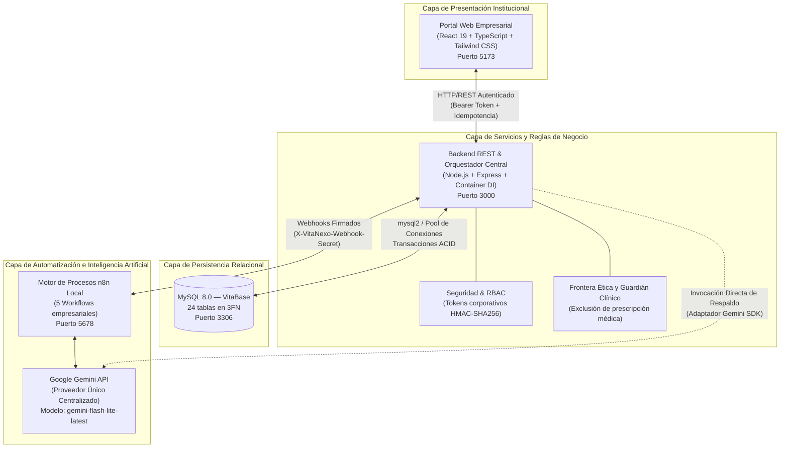
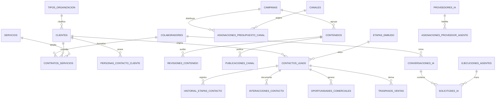

# VitaNexo — Plataforma Tecnológica B2B para Centros de Salud en Costa Rica

Plataforma corporativa integral para la gestión administrativa, comercial, de divulgación estratégica y analítica de negocios orientada a clínicas privadas, consultorios médicos independientes y centros de fisioterapia de Costa Rica.

---

## 1. Identidad Corporativa y Presentación Institucional

**VitaNexo** es una compañía tecnológica B2B costarricense con sede en San José, dedicada al diseño e implementación de soluciones digitales que optimizan los procesos administrativos y comerciales de prestadores de servicios de salud privados en el territorio nacional.

### Misión y Propuesta de Valor
Facilitar a las organizaciones del sector salud herramientas tecnológicas confiables que ordenen su captación comercial, automaticen la divulgación informativa y fortalezcan su toma de decisiones mediante analítica de rentabilidad en colones costarricenses (**CRC**), reduciendo la carga operativa del personal directivo y administrativo.

### Mercado Objetivo en Costa Rica
- **Clínicas pequeñas y medianas**: Centros odontológicos, policlínicos y clínicas de especialidades médicas ambulatorias.
- **Consultorios médicos independientes**: Profesionales de la salud que gestionan su propia práctica privada.
- **Centros de fisioterapia y rehabilitación**: Instalaciones dedicadas a terapia física, readaptación y bienestar integral.
- **Entidades de servicios complementarios**: Laboratorios y centros de diagnóstico ambulatorio.

### Política Estricta de Privacidad y Cero Datos Clínicos
> [!IMPORTANT]
> **FRONTERA ÉTICA Y LEGAL INSTITUCIONAL (CERO DATOS MÉDICOS)**
> 
> VitaNexo opera exclusivamente en el ámbito administrativo, comercial, de mercadeo estratégico y de relación con clientes corporativos. Por diseño arquitectónico y estricta política de gobernanza:
> 1. La plataforma **no recopila, no registra ni almacena expedientes clínicos, diagnósticos médicos, recetas, terapias particulares ni datos sensibles de pacientes**.
> 2. Las herramientas de inteligencia artificial y automatización incorporan filtros de seguridad que detectan y rechazan cualquier solicitud de naturaleza diagnóstica o farmacológica, redirigiendo al colaborador hacia la gestión operativa y comercial de la organización.
> 3. Todos los registros corresponden estrictamente a personas jurídicas, contactos profesionales, iniciativas de divulgación y transacciones comerciales entre empresas (B2B).

---

## 2. Descripción Ejecutiva de los Diez Módulos Funcionales

La plataforma organiza sus capacidades en diez módulos empresariales interconectados:

```
┌─────────────────────────────────────────────────────────────────────────────┐
│                           PLATAFORMA VITANEXO B2B                           │
├───────────────┬──────────────────────────────┬──────────────────────────────┤
│ 1. Inicio     │ 2. Clientes                  │ 3. Servicios                 │
│    (Dashboard)│    (Centros de salud B2B)    │    (Catálogo y contratos)    │
├───────────────┼──────────────────────────────┼──────────────────────────────┤
│ 4. Campañas   │ 5. Contenidos                │ 6. Contactos y ventas        │
│    (Mercadeo) │    (Educación en salud)      │    (CRM y embudo B2B)        │
├───────────────┼──────────────────────────────┼──────────────────────────────┤
│ 7. Indicadores│ 8. Asistente IA              │ 9. Automatizaciones          │
│    (Métricas) │    (4 perfiles de negocio)   │    (Flujos n8n)              │
├───────────────┴──────────────────────────────┴──────────────────────────────┤
│ 10. Administración (Gobierno institucional, roles RBAC y seguridad)          │
└─────────────────────────────────────────────────────────────────────────────┘
```

1. **Inicio (Tablero Ejecutivo)**: Panel central con indicadores clave de rendimiento, facturación mensual estimada en CRC, estado consolidado del embudo de ventas, resumen de iniciativas de divulgación activas y supervisión del estado de los servicios.
2. **Clientes (Directorio de Centros de Salud)**: Directorio exhaustivo de clínicas, consultorios y centros de rehabilitación clientes; registro de cédula jurídica, razón social, ubicación por provincia y cantón costarricense, y personas de contacto autorizadas.
3. **Servicios (Catálogo y Contratos Comerciales)**: Catálogo corporativo de soluciones tecnológicas y paquetes de servicios en colones costarricenses (CRC), control de modalidades de cobro (mensual, anual, único) y formalización contractual con firmas y plazos.
4. **Campañas (Planificación y Divulgación Estratégica)**: Creación y seguimiento de campañas institucionales, definición de objetivos comerciales, topes de inversión por canal digital y análisis de rendimiento publicitario.
5. **Contenidos (Materiales Educativos y Comunicación)**: Redacción y archivo de publicaciones formativas, artículos informativos y comunicados institucionales orientados al fomento de la salud preventiva, con historial de versiones y flujo obligatorio de aprobación humana previa a la publicación.
6. **Contactos y Ventas (CRM Comercial B2B)**: Trazabilidad integral de organizaciones prospecto a lo largo de un embudo comercial estructurado en seis etapas, registro de reuniones, bitácora de llamadas y traspaso formal de oportunidades.
7. **Indicadores (Analítica de Rendimiento y Rentabilidad Comercial)**: Consolidación de métricas de adquisición y rentabilidad en CRC: Costo por Clic (CPC), Tasa de Clics (CTR), Costo de Adquisición de Clientes (CAC), Retorno de la Inversión Publicitaria (ROAS), ciclo comercial y ticket promedio, distinguiendo valor real de negocio frente a métricas de vanidad.
8. **Asistente IA (Centro Institucional de Inteligencia Artificial)**: Interfaz ejecutiva asistida por IA para la planificación de campañas, estructuración de calendarios de contenido, diagnóstico de métricas y calificación de prospectos, con persistencia total y control asíncrono.
9. **Automatizaciones (Supervisión de Procesos Operativos)**: Panel de monitoreo de flujos de trabajo locales basados en n8n, con visualización de estado en tiempo real, trazabilidad de ejecuciones y capacidad de reintento de tareas.
10. **Administración (Gobierno Institucional, Roles y Seguridad)**: Directorio de colaboradores internos, asignación de permisos según el modelo RBAC, estado de la conexión con el motor central de inteligencia artificial y auditoría de políticas de privacidad.

---

## 3. Arquitectura Tecnológica y Empresarial

VitaNexo implementa una arquitectura desacoplada de cuatro capas, orientada a la alta disponibilidad, la trazabilidad estricta y el estricto cumplimiento normativo local.



### Componentes de la Solución

| Componente | Tecnología | Rol Institucional |
|---|---|---|
| **Portal Web (Frontend)** | React 19, TypeScript 5.7, Tailwind CSS v4, Vite 6 | Interfaz empresarial responsiva para los colaboradores de VitaNexo. |
| **Servidor de Negocio (Backend)** | Node.js 20+, Express, Inyección de Dependencias | Ejecución de reglas comerciales, control de acceso, orquestación y transacciones. |
| **Base de Datos Institucional** | MySQL 8.0.40 Community Server (`VitaBase`) | Repositorio estructurado en 3FN con 24 tablas, llaves foráneas e integridad referencial. |
| **Motor de Automatización** | n8n 2.38.6 local | Ejecución asíncrona de flujos de trabajo, integración de webhooks y trazabilidad. |
| **Inteligencia Artificial** | Google Gemini API (`models/gemini-flash-lite-latest`) | Proveedor centralizado único que abastece a los 4 perfiles especializados. |

---

## 4. El Rol de la Inteligencia Artificial Centralizada

VitaNexo adopta el principio de **Una Sola Inteligencia Artificial Central**: un único proveedor corporativo (Google Gemini API), un único servicio de conexión institucional y un único modelo de alto rendimiento compartido entre cuatro perfiles de asistencia especializada.

```
                  ┌──────────────────────────────────────────────┐
                  │          GOOGLE GEMINI API (CENTRAL)         │
                  │        models/gemini-flash-lite-latest       │
                  └──────────────────────┬───────────────────────┘
                                         │
                 ┌───────────────────────┴───────────────────────┐
                 │                                               │
                 ▼                                               ▼
     ┌───────────────────────┐                       ┌───────────────────────┐
     │  PERFIL 1: CAMPAÑAS   │                       │  PERFIL 2: CONTENIDOS │
     │  Estrategia B2B,      │                       │  Educación en salud,  │
     │  segmentación cantonal│                       │  calendarios editor.  │
     │  y presupuesto en CRC │                       │  (Aprobación humana)  │
     └───────────────────────┘                       └───────────────────────┘
                 │                                               │
                 ▼                                               ▼
     ┌───────────────────────┐                       ┌───────────────────────┐
     │  PERFIL 3: INDICADORES│                       │  PERFIL 4: VENTAS     │
     │  Diagnóstico de ROAS, │                       │  Calificación de leads│
     │  CAC, CPC, embudo y   │                       │  comerciales y speech │
     │  rentabilidad real    │                       │  de abordaje B2B      │
     └───────────────────────┘                       └───────────────────────┘
```

### Cuatro Perfiles de Asistencia Especializada
1. **Planificación Estratégica de Campañas (`agente_campanas`)**: Analiza objetivos de captación para centros médicos en cantones específicos de Costa Rica, sugiere distribución presupuestaria en colones costarricenses y genera propuestas tácticas. *Las propuestas se guardan estrictamente en estado preliminar y no activan gasto sin confirmación directiva.*
2. **Creación de Contenido Especializado (`agente_contenido`)**: Redacta publicaciones formativas y calendarios de divulgación enfocados en prevención y gestión clínica. *Ningún contenido generado por IA se divulga automáticamente; requiere revisión y aprobación expresa por parte de un colaborador responsable.*
3. **Diagnóstico de Indicadores de Rendimiento (`agente_metricas`)**: Interpreta las métricas financieras y comerciales calculadas en la base de datos (CAC, ROAS, CPC, CTR, ciclo comercial), detectando cuellos de botella y señalando recomendaciones prioritarias.
4. **Calificación Comercial de Contactos (`agente_contactos_ventas`)**: Evalúa el nivel de madurez y afinidad de los prospectos en el embudo comercial, calculando un puntaje de idoneidad y sugiriendo mensajes de abordaje respetuosos y profesionales.

### Ciclo de Vida Asíncrono de Solicitudes de IA
Para ofrecer una experiencia ágil y tolerante a fallas, las operaciones de inteligencia artificial se procesan de forma asíncrona:

1. **Ingreso y Validación**: El colaborador envía una instrucción desde el portal web.
2. **Autorización y Registro Inmediato**: El backend valida el rol corporativo del usuario, verifica la ausencia de consultas clínicas y crea un registro en `solicitudes_ia` con estado `pendiente` y su respectiva clave de idempotencia (`X-Idempotency-Key`).
3. **Respuesta Rápida HTTP 202 (Accepted)**: El backend devuelve de inmediato el identificador institucional de la solicitud (`SOL-2026-XXXXXX`), liberando la pantalla del usuario.
4. **Procesamiento en Motor de Automatización**: El flujo correspondiente en n8n ejecuta la consulta ante Gemini API, procesa la respuesta en formato estructurado y notifica el resultado al backend.
5. **Persistencia Atómica**: El backend almacena la respuesta definitiva en `VitaBase`, marcando el estado como `completada` y registrando la duración en milisegundos.
6. **Actualización Reactiva**: El portal del colaborador consulta periódicamente el estado de la solicitud y presenta los resultados con distintivos visuales en tiempo real (`pendiente`, `procesando`, `completada`, `error`, `cancelada`).

---

## 5. Modelo de Datos Institucional (`VitaBase` en 3FN)

La base de datos relacional `VitaBase` cuenta con **24 tablas** normalizadas en Tercera Forma Normal (3FN), garantizando consistencia, integridad referencial y trazabilidad completa de cada operación.

### Segmentación de Esquemas Relacionales



1. **Gestión Institucional y Catálogos**: `tipos_organizacion`, `canales`, `colaboradores`, `roles`.
2. **Clientes y Servicios en Salud**: `clientes`, `personas_contacto_cliente`, `servicios`, `contratos_servicios`.
3. **Mercadeo Estratégico y Divulgación**: `campanas`, `asignaciones_presupuesto_canal`, `contenidos`, `revisiones_contenido`, `publicaciones_canal`.
4. **CRM y Relaciones Comerciales B2B**: `contactos_leads`, `etapas_embudo`, `historial_etapas_contacto`, `interacciones_contacto`, `oportunidades_comerciales`, `traspasos_ventas`.
5. **Inteligencia Artificial y Automatizaciones**: `ejecuciones_agentes`, `ejecuciones_workflows_n8n`, `proveedores_ia`, `asignaciones_proveedor_agente`, `conversaciones_ia`, `solicitudes_ia`.

---

## 6. Supervisión de Automatizaciones y Flujos de Trabajo n8n

VitaNexo cuenta con cinco flujos de automatización locales exportados en `n8n/workflows/` e integrados con el motor de procesos:

| Código de Flujo | Denominación Empresarial | Propósito Operativo | Webhook Local Autenticado |
|---|---|---|---|
| `VitaNexoAgCamp01` | **Gestión Estratégica de Campañas** | Orquestación de planes de captación y asignación presupuestaria en CRC. | `POST /webhook/vitanexo/agente-campanas` |
| `VitaNexoAgCont02` | **Creación y Redacción de Contenidos** | Generación de piezas educativas de salud y calendarios de publicación. | `POST /webhook/vitanexo/agente-contenido` |
| `VitaNexoAgMetr03` | **Diagnóstico de Rendimiento Comercial** | Análisis de métricas financieras e interpretación estratégica de resultados. | `POST /webhook/vitanexo/agente-metricas` |
| `VitaNexoAgVent04` | **Calificación Comercial de Prospectos** | Scoring de organizaciones en embudo y sugerencias de abordaje comercial. | `POST /webhook/vitanexo/agente-ventas` |
| `VitaNexoHealth05` | **Supervisión y Salud de Servicios** | Verificación periódica de conectividad con bases de datos y servicios de IA. | `GET /webhook/vitanexo/health` |

Todos los flujos cuentan con cabeceras de seguridad validadas (`X-VitaNexo-Webhook-Secret`), control de límites de ejecución y captura de errores con registro en base de datos.

---

## 7. Seguridad, Control de Acceso y Gobernanza

La plataforma adopta medidas de seguridad adaptadas a los estándares de privacidad empresarial:

- **Autenticación Basada en Tokens**: Emisión de credenciales temporales firmadas mediante HMAC-SHA256 con vencimiento programado (8 horas).
- **Control de Acceso Basado en Roles (RBAC)**:
  - `direccion_comercial`: Acceso global a todos los módulos comerciales, analíticos, de configuración y de IA.
  - `mercadeo`: Gestión de campañas, generación de contenidos e indicadores de divulgación.
  - `contenido`: Redacción y estructuración de publicaciones de salud, sujeta a revisión.
  - `ejecutivo_ventas`: Administración del embudo de prospectos, CRM y cierre de oportunidades.
  - `operaciones`: Supervisión de contratos, servicios y flujos de automatización.
- **Firma de Webhooks Corporativos**: La comunicación entre el backend y el motor n8n está protegida mediante el encabezado obligatorio `X-VitaNexo-Webhook-Secret`.
- **Idempotencia Transaccional**: Toda solicitud crítica incorpora el encabezado `X-Idempotency-Key` para impedir la duplicación accidental de acciones o propuestas presupuestarias.
- **Protección de Datos Sensibles**: Ningún dato de configuración confidencial (claves de acceso, secretos criptográficos, llaves de API) se expone en la interfaz web ni en archivos de seguimiento de versiones.

---

## 8. Puesta en Marcha y Operación Institucional

### Requisitos del Entorno
- **Sistema Operativo**: Windows 10/11, macOS o Linux.
- **Entorno de Ejecución**: Node.js v20 LTS o superior.
- **Base de Datos**: MySQL Community Server 8.0 o superior (puerto `3306`).
- **Motor de Automatización**: n8n local (puerto `5678`).
- **Shell de Comandos**: PowerShell 5.1+ o terminal POSIX compatible.

### Preparación de Variables de Entorno
Copie los archivos de ejemplo y configure las credenciales locales de su entorno:

```bash
# Entorno principal de Backend y Automatizaciones
cp .env.example .env

# Entorno del portal web de clientes
cp frontend/.env.example frontend/.env
```

> [!NOTE]
> En el archivo `.env`, verifique que `MYSQL_DATABASE=VitaBase`, `MYSQL_USER=vitanexo_app`, `N8N_BASE_URL=http://127.0.0.1:5678` y que la clave `GEMINI_API_KEY` se encuentre debidamente asignada con su modelo central `GEMINI_MODEL=models/gemini-flash-lite-latest`.

### Instalación de Dependencias
```bash
# Dependencias del servidor backend
npm install

# Dependencias de la interfaz empresarial
npm --prefix frontend install
```

### Inicialización y Migración No Destructiva de Base de Datos
Los scripts de migración son aditivos y respetan cualquier base de datos preexistente:
```bash
# 1. Auditoría de lectura de la base de datos
npm run db:inspect

# 2. Creación aditiva de tablas y esquemas
npm run db:migrate

# 3. Poblado con datos institucionales iniciales (sin duplicados)
npm run db:seed
```

### Importación de Flujos de Automatización en n8n
```bash
# Construye e importa los 5 flujos empresariales a la base local de n8n
npm run n8n:build
npm run n8n:import
```

### Inicio, Verificación y Detención de la Plataforma
VitaNexo dispone de secuencias automatizadas en PowerShell para el control integral de los servicios:

```powershell
# Iniciar todos los servicios (MySQL, n8n, Backend y Frontend)
powershell -ExecutionPolicy Bypass -File scripts/start-vitanexo.ps1

# Consultar el estado operativo y puertos de los servicios en ejecución
powershell -ExecutionPolicy Bypass -File scripts/status-vitanexo.ps1

# Detener todos los servicios de forma ordenada
powershell -ExecutionPolicy Bypass -File scripts/stop-vitanexo.ps1
```

### Puntos de Acceso Local
- **Portal Web Empresarial**: `http://127.0.0.1:5173`
- **Servidor de Aplicación (API REST)**: `http://127.0.0.1:3000`
- **Panel de Automatizaciones (n8n)**: `http://127.0.0.1:5678`
- **Verificación de Salud del Sistema**: `http://127.0.0.1:3000/api/health`

---

## 9. Estado de Verificación y Certificación Operativa

El sistema cuenta con certificación de calidad de extremo a extremo:

- **Pruebas Automatizadas**: 42 de 42 pruebas aprobadas al 100% (`npm test`), abarcando pruebas unitarias, integración con MySQL `VitaBase`, validación del orquestador, políticas de acceso RBAC, salvaguardas de frontera clínica y pruebas asíncronas de IA.
- **Validación de Inteligencia Artificial**: Se verificó la ejecución exitosa de los cuatro perfiles de IA con el modelo centralizado `models/gemini-flash-lite-latest`, registrando tiempos de respuesta promedio de 940 ms a nivel de API directa y entre 3.6 y 4.9 segundos en ciclos completos asíncronos con n8n y persistencia en base de datos.
- **Compilación de Producción**: Verificación de empaquetado de la interfaz de usuario con TypeScript en modo estricto y Vite 6 sin errores (`npm --prefix frontend run build`).

---

**VitaNexo S.A. — Soluciones Digitales y Administrativas para el Sector Salud**  
San José, Costa Rica · Moneda Oficial: Colón Costarricense (CRC)  
*Documentación técnica institucional de uso interno y comercial.*
